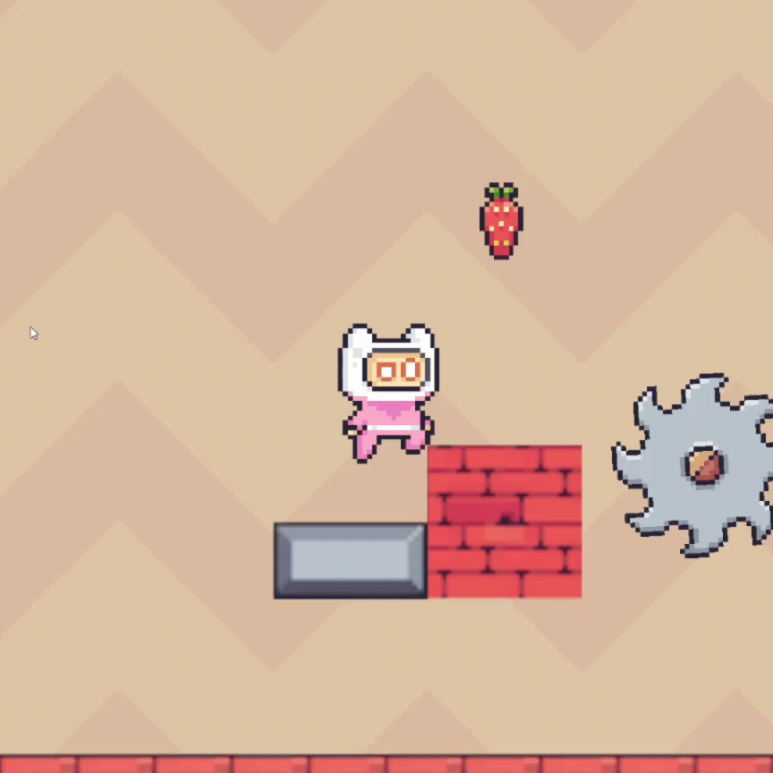

# NOT a virus

Joc facut acum 4 ani cu un nume foarte inspirat. Platformer 2D în stil pixel art, făcut în **Unity**. Controlezi un personaj mic și alb-roz printr-o serie de nivele cu capcane, strângând căpșuni pe drum.

## Cum se joacă

- Parcurgi nivelul spre dreapta, sărind peste obstacole și platforme.
- **Scopul** este să aduni cât mai multe **căpșuni 🍓**. Numărul lor apare în colțul din stânga sus (`Strawberries: N`).
- Capcanele te resetează, așa că trebuie să sari la momentul potrivit.

### Controale

| Acțiune | Tastă |
|---|---|
| Mișcare stânga / dreapta | `A` / `D` |
| Săritură | `Space` |

## Elemente din joc

| Element | Descriere |
|---|---|
| 🍓 **Căpșuni** | Obiecte de colectat. Cresc scorul afișat în colțul ecranului. |
| ⚙️ **Fierăstraie rotative** | Obstacole periculoase. Unele stau fixe, altele sunt montate pe un stâlp sau pe o platformă. |
| 🔺 **Țepi** | Se găsesc pe sol, în gropi și pe platforme. Evită-i sau sari peste ei. |
| 🟫 **Platforme mici** | Platforme suspendate pe care poți ateriza ca să treci peste țepi. |
| 🧱 **Blocuri de cărămidă / metal** | Blocuri solide folosite ca trepte și ca platforme. |

## Nivele / teme

- **Nivelul 1: lumea roz.** Teren cu glazură roz, țepi simpli și primele fierăstraie. Servește ca introducere.
- **Nivelul 2: lumea de cărămidă.** Fundal bej cu model în zigzag și blocuri roșii de cărămidă. Fierăstraiele sunt așezate între trepte, iar mai departe apar câmpuri lungi de țepi, cu blocuri între ele pe care trebuie să sari.
- - **Nivelul 3: lumea albastra.** Teren cu glazură albastră, are mai mulți țepi, mai multe fierăstraie și este ultimul nivel din joc.

## Rulare

Descarcă **release-ul**, dezarhivează-l si rulează fișierul `.exe`

## Credite

Asseturi de pe Unity Asset Store (https://assetstore.unity.com)
